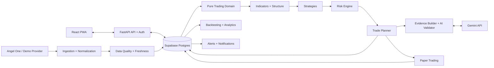

# TRADEIQ — Full Product Blueprint & Step-by-Step Development Plan

**Document version:** 1.0  
**Prepared:** 18 November 2026  
**Project:** TRADEIQ  
**Purpose:** A personal, AI-assisted trading intelligence platform for Indian NSE cash equities  
**Initial broker:** Angel One SmartAPI  
**Initial AI provider:** Gemini, behind a provider-independent interface  
**Initial trading modes:** Intraday and Swing  
**Initial execution mode:** Paper trading only — no real-money order placement

---

## 0. Executive summary

TRADEIQ will be a private, mobile-first trading intelligence platform. It will collect market data, validate it, calculate technical indicators, detect predefined trading setups, calculate risk and position size, explain the result with AI, and let the user paper-trade and review performance.

It is **not** intended to predict the market with certainty or generate guaranteed-profit calls. The system must be willing to say **NO TRADE** whenever data is stale, a setup is incomplete, risk limits are breached, or the expected reward does not justify the risk.

The central engineering principle is:

> **Market data, strategy decisions, position sizing, risk limits and backtest fills must be deterministic, testable and reproducible. AI may explain verified evidence, but it cannot invent prices, create signals independently, change risk calculations or place orders.**

### Confirmed user decisions

| Decision | Selected value |
|---|---|
| Broker | Angel One |
| Market | Indian stock market |
| Exchange | NSE |
| Initial instruments | NSE cash equities |
| Trading styles | Intraday + Swing |
| Approximate capital range | ₹50,000–₹1,00,000 |
| Product use | Personal use only |
| AI provider | Gemini initially |
| First release execution | Paper trading only |
| Public SaaS / multi-user product | Not in initial scope |
| Futures and options | Not in initial scope |
| Live order execution | Not in initial scope |

The capital amount must remain configurable. The application must not assume that the user always has the same capital.

---

# PART I — EXISTING PROJECT AUDIT AND MIGRATION STRATEGY

## 1. Existing project reviewed

The supplied ZIP is named:

`Market-Analysis-crypto--main (1).zip`

Its README identifies the existing application as **ApexQuant Dual-Market Crypto + NSE v5.2**.

The inspected source tree contains:

```text
Market-Analysis-crypto--main/
  README.md
  backend/
    main.py
    analysis_engine.py
    angel_feed.py
    stock_live.py
    stock_premarket.py
    gemini_pool.py
    news_hub.py
    research_engine.py
    data_sources.py
    universe.py
    crypto_engine.py
    boom_engine.py
  frontend/
    index.html
    coin.html
```

The source was inspected as code. This is not a claim that the application was executed, its live broker credentials were tested, or its deployment/security was fully audited.

## 2. Existing module inventory and decisions

| Existing module | Existing responsibility (based on source review) | TRADEIQ decision | Reason / required work |
|---|---|---|---|
| `backend/angel_feed.py` | Angel One SmartAPI authentication/TOTP flow, instrument-token handling and live-feed integration | **Reuse selectively; refactor into provider adapter** | Valuable starting point. Verify current SmartAPI requirements, token lifecycle, reconnect handling, data timestamps, rate limits and error handling. Keep credentials backend-only. |
| `backend/stock_live.py` | NSE live momentum radar, signal/alert logic and tracking | **Reuse logic selectively; refactor** | Useful starting point for scanner concepts. Revalidate every rule, avoid duplicate strategy implementations, and make the new scanner call the shared domain strategy engine. |
| `backend/stock_premarket.py` | Pre-market analysis and market context | **Reuse selectively** | Keep useful market-context logic only after source, timestamp and calculation checks. Missing or unavailable inputs must be explicit. |
| `backend/analysis_engine.py` | Trend, candlestick, support/resistance and trade-plan analysis | **Extract and refactor** | Separate pure calculations from API/data/AI concerns. Remove fixed capital/risk constants and route all sizing through the new risk engine. Confirm no look-ahead or incomplete-candle confirmation. |
| `backend/gemini_pool.py` | Gemini API request/key handling | **Reuse provider concepts; rebuild AI boundary** | Gemini should sit behind an LLM interface. Add evidence packets, strict JSON schema validation, numeric grounding and deterministic fallback. Never give the model authority over risk or orders. |
| `backend/news_hub.py` | News collection/summary support | **Reuse selectively** | Validate source reliability, timestamps, duplicate handling and link provenance. Treat article content as untrusted input. AI summaries must be labelled interpretation. |
| `backend/research_engine.py` | Research and risk-oriented analysis | **Audit before reuse** | Reuse only discrete, testable functions. Do not let AI/research code become a second strategy or risk engine. |
| `backend/data_sources.py` | External data-source helpers | **Audit and adapt** | Keep only sources that are permitted, reliable and clearly identified. No scraping or unofficial source as a substitute for a licensed feed. |
| `backend/universe.py` | Stock-universe definitions | **Reuse as seed/reference, then maintain properly** | Build a validated instrument master with exchange, symbol, token, tick size, status and source metadata. |
| `backend/main.py` | Large FastAPI application and API orchestration | **Rebuild as modular FastAPI application** | It is a large monolithic file. Move routes, services, repositories, providers, jobs and domain logic into separate modules. Review permissive CORS and endpoint authorization. |
| `backend/crypto_engine.py` | Crypto analysis | **Exclude from initial TRADEIQ** | Crypto is outside the agreed NSE cash-equity scope. |
| `backend/boom_engine.py` | Crypto momentum/boom radar | **Exclude from initial TRADEIQ** | Crypto is outside initial scope. |
| `frontend/index.html` | Existing stock/dashboard UI | **Rebuild in React + TypeScript** | Preserve useful UX ideas, not the monolithic implementation. Use typed API contracts and reusable components. |
| `frontend/coin.html` | Crypto UI | **Exclude from initial TRADEIQ** | Crypto is outside initial scope. |
| Existing paper-trade persistence | Supabase REST plus local JSON fallback was observed in the existing project | **Replace with structured Postgres repositories and migrations** | Supabase Postgres is the source of truth. Local JSON must not silently become production storage. |

### Specific issues to resolve during migration

1. The existing `analysis_engine.py` contains fixed capital/risk constants (including a ₹1,00,000 capital assumption and fixed risk/exposure percentages). These must be removed from the new domain logic.
2. Check whether the live scanner, analysis engine, charts and trade levels all use the same candle/quote source and compatible timestamps.
3. Review the existing FastAPI CORS configuration; wildcard origins must not be used in production.
4. Review every API endpoint for authentication and authorization, especially create/update/delete operations on paper trades and user data.
5. Check whether any provider tokens or secrets are stored in frontend code, logs, source files or unencrypted storage.
6. Check whether local JSON fallback can cause data loss, stale state or conflicting records.
7. Confirm whether historical data is adjusted for splits/bonuses and whether the adjustment policy is consistent in charts and backtests.
8. Existing source presence is not proof of correct behaviour. Every reused calculation must receive tests before it is trusted.

### Migration rule

Keep the old repository untouched as a backup. Create a clean TRADEIQ implementation. Port only reviewed modules/functions into it. Do not delete the old project until the new version has passed the relevant acceptance tests.

---

# PART II — PRODUCT SCOPE AND USER EXPERIENCE

## 3. What TRADEIQ will do

The application should help answer:

- What is the current NSE market state?
- Which stocks are worth watching today?
- Is a stock near a valid setup or has it actually confirmed one?
- What are the entry zone, stop-loss and target proposals?
- How many shares fit within my risk and exposure limits?
- What is the estimated net risk-to-reward after costs and slippage?
- Why did a setup pass or fail?
- Is the data live, delayed, historical, simulated, stale or unavailable?
- What happened to my paper trades?
- Which strategies and behaviours have performed better in historical tests and in my paper journal?

## 4. Features by release

### Initial release (must build)

1. Secure single-user login.
2. Market status and data-freshness display.
3. Angel One connection foundation.
4. NSE cash instrument list.
5. Historical candle retrieval and validation.
6. Technical indicators.
7. Stock scanner.
8. Four initial strategy templates.
9. Multi-timeframe confirmation.
10. Risk calculator and trade planner.
11. Evidence-grounded Gemini explanations.
12. Paper trading.
13. Trading journal.
14. Basic performance analytics.
15. Backtesting with integrity safeguards.
16. Watchlists and in-app alerts.
17. Mobile-first PWA experience.

### Explicitly out of scope initially

- Live order placement or automated execution.
- Options, futures and commodity trading.
- Crypto market features.
- Public multi-user SaaS.
- Selling or redistributing market data/signals.
- Social/copy trading.
- AI-generated autonomous trading.
- Complex portfolio optimisation before the core ledger and risk engine are validated.

---

# PART III — LOCKED TECHNICAL ARCHITECTURE

## 5. System architecture

### Frontend

- React
- TypeScript
- Vite
- Tailwind CSS with design tokens
- TanStack Query for server state
- TradingView Lightweight Charts
- React Router
- PWA support
- Mobile-first responsive design

The browser talks only to the TRADEIQ backend for protected operations. Broker secrets and Gemini keys must never be sent to the browser.

### Backend

- Python
- FastAPI
- Pydantic
- Modular services and repositories
- Typed request/response contracts
- Background jobs triggered by protected cron endpoints or a suitable scheduler

### Database and authentication

- Supabase PostgreSQL
- Supabase Auth
- Row Level Security (RLS)
- Supabase CLI SQL migrations
- Service-role credentials on backend only

### Market data

- Angel One SmartAPI first adapter, subject to current eligibility, API terms and entitlements.
- Provider interface so a second provider can be added later.
- Demo provider for development and offline testing.
- Every quote/candle must carry source, timestamp and freshness.

### AI

- Gemini initially.
- Provider-independent LLM client.
- Evidence packet → model → schema validation → numeric grounding → safe response.
- Template fallback if AI fails validation or is unavailable.

### Charts

- TradingView Lightweight Charts.
- Candles, volume, EMA/VWAP overlays, RSI/MACD panes, support/resistance zones, and plan levels.
- Chart values must be tied to the same normalized data used by the scanner and planner.

## 6. Architecture diagram



## 7. Six architectural rules

1. `domain/` is pure Python. It cannot call a network API, database, FastAPI route, provider or LLM.
2. Live scanner, planner and backtester must use the same strategy and risk code.
3. Every market value has a provenance envelope: value, source, as-of timestamp in IST and freshness class.
4. Freshness classes: `LIVE`, `DELAYED`, `HISTORICAL`, `SIMULATED`, `UNAVAILABLE`, plus computed `STALE`. Stale/unavailable data cannot produce an actionable paper-trade plan.
5. Closed candles confirm signals. An in-progress candle may be displayed only as `PROVISIONAL`.
6. Use `Decimal` or integer paise for money. Do not use binary floating-point for financial amounts. Round prices to the instrument's valid tick size.

## 8. Repository structure

```text
tradeiq/
  README.md
  .env.example
  .gitignore
  docs/
    ARCHITECTURE.md
    EXISTING_PROJECT_AUDIT.md
    DATA_PROVIDERS.md
    STRATEGIES.md
    RISK_MODEL.md
    BACKTESTING.md
    SECURITY.md
    RUNBOOK.md
    decisions/
  db/
    migrations/
    seed/
  frontend/
    src/
      app/
      pages/
      features/
        dashboard/
        market/
        scanner/
        stock-detail/
        planner/
        risk/
        paper/
        journal/
        backtest/
        alerts/
        news/
        assistant/
        settings/
      components/
      charts/
      lib/
      styles/
    tests/
    e2e/
  backend/
    app/
      main.py
      core/
      api/v1/
      schemas/
      services/
      repositories/
      providers/
      domain/
        calendar/
        candles/
        indicators/
        structure/
        strategies/
        risk/
        planner/
        paper/
        backtest/
        analytics/
      ai/
      jobs/
    tests/
  .github/
    workflows/
```

**Import boundary:** `backend/app/domain/` must not import from `api/`, `repositories/`, `providers/`, `services/` or `ai/`. Enforce this in CI.

---

# PART IV — MARKET DATA AND ANGEL ONE

## 9. Angel One integration plan

The existing project has `angel_feed.py`, which is the starting point for the adapter. Do not copy it blindly.

### Tasks

1. Read current official SmartAPI documentation and terms before implementation.
2. Confirm that the Angel One account is eligible for the required API access.
3. Confirm current market-data permissions, historical candle availability, rate limits, WebSocket limits and authentication requirements.
4. Verify whether static outbound IP requirements apply to the intended personal deployment.
5. Confirm token/session expiry and reconnect behaviour.
6. Implement a `MarketDataProvider` interface.
7. Implement `DemoMarketDataProvider` first.
8. Refactor Angel One code into `AngelOneProvider`.
9. Add instrument master/token mapping with cache and refresh.
10. Add historical candle retrieval.
11. Add WebSocket connection lifecycle, heartbeat, reconnect and subscription handling.
12. Normalize all values into common internal models.
13. Store source and timestamp with every returned value.
14. Show a reconnect state if authentication expires.
15. Add recorded fixtures so tests do not require a live broker session.

### Required normalized models

**Quote**

- instrument ID and symbol
- exchange
- last traded price
- previous close
- open/high/low
- volume
- source
- exchange/provider timestamp
- received timestamp
- freshness
- data quality status

**Candle**

- instrument ID
- timeframe
- start timestamp
- open/high/low/close
- volume
- source
- ingestion timestamp
- closed/provisional flag
- adjustment status

### Data-quality checks

- Missing values.
- Duplicate candles.
- Out-of-order timestamps.
- Invalid OHLC relationships.
- Negative volume.
- Unexpected price jumps.
- Missing session bars.
- Stale feed.
- Wrong timezone or session anchor.
- Instrument suspended or unavailable.

Do not silently fabricate missing candles. A bad candle should be quarantined or marked invalid, and the affected instrument should show `DATA UNAVAILABLE` when appropriate.

### Time handling

- Store timestamps in UTC where practical.
- Display market times in `Asia/Kolkata`.
- NSE regular session calendar and holidays must be explicit.
- 5-minute session bars should use a documented 09:15 IST anchor.
- Derive 15m, 30m and 1h candles from 5m only with a tested aggregation rule. Daily candles should use the provider/exchange session definition.

---

# PART V — DOMAIN LOGIC: INDICATORS, STRATEGIES AND RISK

## 10. Technical indicators

Initial indicator set:

| Indicator | Initial parameters | Purpose |
|---|---|---|
| EMA | 9, 20, 50, 200 | Trend and dynamic context |
| RSI | 14, Wilder smoothing | Momentum context |
| MACD | 12, 26, 9 | Momentum/trend confirmation |
| VWAP | Session | Intraday price/volume reference |
| ATR | 14, Wilder smoothing | Volatility and stop/zone sizing |
| Volume average | 20 bars | Relative participation |
| Relative volume | Configurable lookback | Compare current volume with baseline |

Requirements:

- Indicators calculated from normalized candles.
- Closed-candle rules clearly defined.
- Golden test fixtures and reference comparisons.
- No future candles in calculations.
- Document warm-up periods and missing data behaviour.
- Indicators are evidence, not automatic buy/sell decisions.

## 11. Market structure and support/resistance

Implement:

- Swing highs and lows.
- Trend structure (higher highs/higher lows and lower highs/lower lows).
- Support and resistance zones.
- Breakout and breakdown detection.
- Retest detection.
- ATR-based zone width.
- Touch count and zone strength evidence.

A pivot becomes usable only after its confirmation bars have closed. This avoids using future information to label an earlier setup.

Candlestick patterns such as hammer, shooting star and engulfing may be displayed as annotations. A candle pattern alone must never create a trade signal.

## 12. Initial strategy set

Each strategy is a versioned Python class with a pure interface:

```python
evaluate(candles_by_timeframe, market_context, params, as_of) -> StrategyResult
```

Every result includes:

- status
- direction
- rule-by-rule results
- observed values and thresholds
- timeframe and candle timestamp
- proposed levels
- invalidation condition
- provisional flag
- explanation keys

### Strategy A — Breakout + Retest

Possible evidence:

- Identified resistance zone.
- Candle closes above the zone.
- Breakout volume meets configured threshold.
- Retest occurs within allowed tolerance.
- Retest holds on a closed candle.
- Higher timeframe does not conflict.
- Entry, stop and target pass risk validation.

### Strategy B — Support Bounce

Possible evidence:

- Identified support zone.
- Price tests the zone.
- Rejection/confirmation on a closed candle.
- Volume/momentum confirmation where configured.
- Stop below invalidation structure.
- Net reward-to-risk passes the configured minimum.

### Strategy C — Trend Following

Possible evidence:

- Trend structure agrees with direction.
- EMA alignment and slope meet parameters.
- Price action is not excessively extended.
- Pullback/continuation trigger is confirmed.
- Higher and lower timeframes do not materially conflict.

### Strategy D — Breakdown + Retest

Possible evidence:

- Identified support zone.
- Closed candle breaks below support.
- Retest fails.
- Volume and momentum confirmation where configured.
- Stop and target are on correct sides.
- Risk and net R:R pass.

These are strategy frameworks, not guaranteed profitable systems. Exact thresholds must be configurable, versioned and validated by backtesting and paper trading. Do not tune them to make a historical chart look attractive.

## 13. Multi-timeframe analysis

Initial timeframes:

- 5-minute
- 15-minute
- 1-hour
- 4-hour
- Daily

Each strategy defines the role of each timeframe, for example:

- Context: Daily
- Setup: 1-hour or 15-minute
- Trigger: 5-minute

The aligner reports:

- higher-timeframe direction
- setup timeframe state
- trigger confirmation
- conflicts
- missing data
- final confirmation status

A material timeframe conflict blocks confirmation. Do not average conflicting signals into a misleading positive score.

## 14. Deterministic risk engine

Initial configurable defaults:

| Setting | Initial default |
|---|---:|
| Risk per trade | 0.5% of account capital |
| Daily loss limit | 1% of account capital |
| Maximum open positions | 2 |
| Maximum single-position exposure | 25% of capital |
| Minimum net risk-to-reward | 1:2 |
| Capital | User configurable, initially ₹50,000–₹1,00,000 |

These are starting guardrails, not a claim that these settings are optimal or safe for every market condition.

### Core calculations

For a long trade:

- raw risk per share = entry − stop
- allowed risk = capital × risk percentage
- cost-aware loss per share includes adverse slippage and round-trip charges
- risk-limited quantity = floor(allowed risk / all-in loss per share)

Then cap quantity by:

- capital/exposure limit
- available funds/margin assumptions
- liquidity constraints
- instrument rules
- maximum open positions
- sector exposure if configured
- daily/weekly risk lock

For a short trade, reverse the stop/entry relationship and validate the instrument and product constraints. The initial product is an analysis/paper tool; do not imply that every short setup is executable in every product type.

### Cost model

Configurable, effective-dated inputs for:

- brokerage
- exchange transaction charges
- statutory charges
- GST
- stamp duty
- other applicable fees
- slippage

Do not hard-code current fee rates. Verify them against the broker's latest charge sheet before enabling accurate net calculations. Intraday and delivery profiles may differ.

### Rejection rules

Reject a plan when:

- stop is on the wrong side
- risk per unit is zero or negative
- calculated quantity is zero
- exposure/capital limit is breached
- daily/weekly loss lock is active
- data is stale or unavailable
- instrument is suspended/unavailable
- strategy rules fail
- net R:R is below minimum
- required timeframe confirmation is missing

Every rejection returns a machine-readable reason code plus a plain-language explanation.

### Risk ownership

The risk engine is the sole authority for:

- quantity
- risk amount
- costs
- slippage
- exposure
- net R:R
- daily/weekly lock
- paper-trade eligibility

Gemini cannot change these values.

---

# PART VI — AI DESIGN

## 15. Gemini's role

AI may:

- explain why a setup passed or failed
- summarise a verified market snapshot
- explain risk/reward calculations already performed by the risk engine
- summarise news with source and timestamp
- identify journal patterns from supplied records
- answer questions through fixed read-only application tools

AI may not:

- invent market prices, indicators or news
- independently generate an actionable signal
- change entry, stop, target, quantity or risk
- bypass a risk lock
- change plan status
- place or modify an order
- access the database directly
- treat an article/headline as an instruction

## 16. Evidence-grounding pipeline

1. Backend creates an evidence packet containing plan, rule results, observed values, thresholds, source/timestamps, risk decision and limitations.
2. Each fact receives a stable fact ID.
3. Gemini is instructed to use only those facts, cite fact IDs and state when information is missing.
4. Gemini returns structured JSON matching a Pydantic schema.
5. Validator checks schema, fact IDs, numbers, status consistency and unsupported claims.
6. One retry may be attempted for a validation failure.
7. If validation still fails or AI is unavailable, show a deterministic template explanation.
8. Label AI news summaries as interpretation, not verified fact.

The assistant uses fixed read-only tools such as `get_analysis`, `get_plan`, `calc_quantity` and `get_journal_stats`. It never gets unrestricted database or broker access.

Required response sections:

1. Data used
2. Analysis
3. Evidence
4. Risks and limitations
5. Conclusion
6. Timestamp

---

# PART VII — DATABASE, SECURITY AND RELIABILITY

## 17. Database schema plan

All user-owned tables carry `user_id` referencing `auth.users`. Use UUID primary keys and `created_at`/`updated_at` where appropriate.

### Global/reference market tables

- `market_instruments`
- `historical_prices`
- `market_snapshots`
- `technical_indicators` (optional cache)
- `market_news`
- `exchange_calendar`

### Strategy and trade-plan tables

- `trading_strategies`
- `strategy_parameters`
- `trade_plans`
- `trade_plan_events`

### User tables

- `users` / profile
- `user_settings`
- `watchlists`
- `watchlist_stocks`
- `price_alerts`
- `user_notifications`
- `trading_journal`
- `paper_orders`
- `paper_positions`

### Backtest tables

- `backtest_runs`
- `backtest_trades`

### Private backend-only schema

- `private.provider_credentials`
- `private.audit_log`

Provider tokens must be encrypted at rest with an application-level encryption key. Only backend service code may read them.

### Key constraints and indexes

- Unique `(exchange, symbol)` for instruments.
- Primary key `(instrument_id, timeframe, ts)` for candles.
- OHLC checks: high >= max(open, close), low <= min(open, close), volume >= 0.
- Index user plans by `(user_id, status, created_at desc)`.
- Index paper positions by `(user_id, status)`.
- Index journal by `(user_id, trade_date desc)`.
- Index active alerts by `(user_id, active)`.
- Index news by `(related_symbol, published_at desc)`.

### RLS

- Enable RLS on all tables.
- User-owned rows: only matching `auth.uid()` can select/insert/update/delete.
- Global market tables: authenticated users read-only.
- Backend service role writes global ingestion data.
- Service-role key never goes to the frontend.
- Test with two separate users to prove cross-user isolation, even though initial deployment is personal-use.

### Data retention

A 5-minute NSE session has 75 bars. At 200 symbols, that is approximately 15,000 bars/day. Retention must be planned against the actual Supabase plan and storage limits.

Initial proposed policy:

- Keep daily candles longer-term.
- Keep 5-minute candles for a rolling period (e.g. 60 days) for the selected scan universe, subject to storage verification.
- Derive 15m/30m/1h from 5m with a documented 09:15 IST anchor.
- Do not delete data needed by a saved backtest without retaining the data hash, assumptions and required source data or a durable reference.

## 18. Security requirements

- `.env` ignored by Git.
- `.env.example` contains placeholders only.
- Secrets only in backend environment/secret manager.
- Supabase service role key backend-only.
- Provider credentials encrypted at rest.
- Verify Supabase JWT on protected API requests.
- Server-side authorization plus RLS.
- Pydantic validation for request bodies and query parameters.
- CORS restricted to known frontend origins.
- Rate limits for user API and provider calls.
- Protected cron endpoints with a separate secret.
- Structured logs without secrets or sensitive account data.
- Audit settings changes, provider connections and plan state changes.
- Sentry or equivalent error tracking after secret scrubbing.
- Backups and a documented restore test.
- No public write endpoint for paper trades, plans or settings.

---

# PART VIII — APPLICATION PAGES AND INTERACTION DESIGN

## 19. Navigation

### Desktop/tablet

Left sidebar plus top bar.

Top bar shows:

- market state: pre-market/open/closed/holiday/unavailable
- data-freshness status
- demo-mode banner
- provider connection state

### Mobile

Bottom navigation with five items:

- Home
- Scanner
- Planner
- Paper
- More

The More page links to journal, backtesting, watchlists, alerts, news, analytics and settings.

Touch targets should be at least 44px. Test at 360px, 390px and 412px viewport widths.

## 20. Pages

| Page | Contents |
|---|---|
| Login / Signup | Supabase Auth, secure session, disclaimer acknowledgement |
| Dashboard | Market state, index snapshots, breadth, sector overview, open plans, risk-lock status |
| Market Overview | Breadth, sectors, volatility context, volume participation |
| Stock Scanner | Filterable stock list, strategy category, freshness and liquidity warning |
| Stock Detail | Price, indicators, zones, multi-timeframe state, rule checklist, news |
| Technical Chart | Candles, EMA/VWAP, RSI/MACD, volume, S/R zones, plan levels |
| AI Trade Planner | Plan, status, expiry, evidence, risk decision, rejection reasons |
| Risk Calculator | Capital, stop, quantity, charges, exposure and daily lock |
| Watchlists | Multiple lists, price change, setup status, alerts |
| Paper Trading | Virtual capital, open positions, orders, fills, P&L |
| Trading Journal | Entry/exit, screenshots, setup, emotions, mistakes, lessons |
| Backtesting | Strategy/version, universe, date range, metrics, equity, drawdown, OOS |
| News & Events | Source-linked feed, timestamps, AI summary labelled interpretation |
| AI Assistant | Grounded explanations and read-only queries |
| Performance Analytics | Win rate, expectancy, R, drawdown, costs, strategy/month views |
| Settings | Capital, risk limits, cost/slippage assumptions, theme |
| Provider Settings | Connect/disconnect, token status, freshness diagnostics; never display secrets |

Every plan must show a disclaimer: analytical/educational tool, not a guarantee of results or a substitute for independent judgement.

---

# PART IX — STEP-BY-STEP DEVELOPMENT ROADMAP

## 21. Realistic time estimate

This is a substantial software project, not a one-prompt website build.

A realistic planning estimate for one developer using AI assistance:

- **Part-time (2–3 focused hours/day): approximately 14–20 weeks**
- **Near full-time (6–8 focused hours/day): approximately 8–12 weeks**

These are planning ranges, not guarantees. Broker API approvals, data access, deployment constraints, bugs and backtest validation can extend the schedule. Do not compress testing to meet a calendar target.

Each milestone must end with a runnable build, passing tests and a Git commit before the next milestone begins.

## 22. Phase 0 — Project audit and decisions

**Estimate: 2–4 days**

### Step 0.1 — Preserve the existing code

- Create a backup branch/repository for ApexQuant.
- Record its current commit/hash if available.
- Do not edit or delete the original project during the initial audit.

**Deliverable:** preserved baseline.

### Step 0.2 — Audit modules and data flow

- Trace Angel One login and token handling.
- Trace WebSocket tick path.
- Trace historical candle path.
- Trace scanner calculations.
- Trace trade-plan calculations.
- Trace paper-trade storage and API endpoints.
- Trace Gemini and news calls.
- Identify hard-coded capital, risk and market assumptions.
- Identify authentication, CORS and credential risks.

**Deliverable:** `docs/EXISTING_PROJECT_AUDIT.md` with reuse/refactor/rebuild decisions.

### Step 0.3 — Confirm provider feasibility

- Check official Angel One SmartAPI documentation and account entitlements.
- Check data permissions, history limits, rate limits, session expiry, WebSocket limits and deployment/static-IP requirements.
- Do not put credentials in source code or share them in chat.

**Deliverable:** `docs/DATA_PROVIDERS.md` and a list of verified versus unverified items.

### Step 0.4 — Freeze the initial scope

- NSE cash equities only.
- Intraday + Swing.
- Personal use.
- Gemini initial provider.
- Paper trading only.
- No live order execution.

**Exit gate:** audit complete, scope frozen, known blockers recorded.

## 23. Phase 1 — Foundation

**Estimate: 1–2 weeks**

### Milestone 1.1 — Repository and developer setup

- Create clean `tradeiq/` monorepo.
- Add frontend and backend directories.
- Add `.gitignore`, `.env.example`, README.
- Configure Python environment and dependency lock.
- Configure Node package manager and lockfile.
- Add formatting/linting/type-check commands.
- Add CI workflow for lint, type-check and tests.
- Preserve old ApexQuant code separately.

**Acceptance:** fresh clone can install dependencies and run the empty frontend/backend using README instructions.

### Milestone 1.2 — FastAPI foundation

- Create FastAPI app factory.
- Add `/health` endpoint.
- Add versioned API prefix `/api/v1`.
- Add Pydantic settings and environment validation.
- Add structured JSON logging.
- Add standard error response format.
- Add CORS allow-list from environment.
- Add request IDs and safe exception handling.

**Acceptance:** health endpoint works; missing config fails clearly; no secrets appear in logs.

### Milestone 1.3 — React foundation

- Create Vite React TypeScript app.
- Add Tailwind and design tokens.
- Add router.
- Add API client and TanStack Query.
- Add global loading, empty, error and unavailable states.
- Add mobile navigation shell.
- Add desktop sidebar.
- Add dashboard placeholder cards.

**Acceptance:** responsive shell works at 360/390/412px without horizontal overflow.

### Milestone 1.4 — Supabase project and migrations

- Create Supabase project.
- Configure local Supabase CLI.
- Add initial migrations.
- Add user profile and settings tables.
- Add RLS policies.
- Add seed script for clearly labelled demo data.
- Add migration/rollback notes.

**Acceptance:** migrations apply from clean state; RLS test proves user A cannot access user B's rows.

### Milestone 1.5 — Authentication

- Add signup, login, logout and session restore.
- Protect frontend routes.
- Verify JWT on backend.
- Add unauthorized API tests.
- Keep service-role key backend-only.

**Acceptance:** unauthenticated API calls return 401; login survives refresh; logout clears session.

### Milestone 1.6 — Demo mode

- Implement explicit `DEMO_MODE`.
- Seed sample instruments and clearly synthetic data.
- Add permanent Demo banner and `SIMULATED` chips.
- Ensure demo data cannot be presented as live.

**Acceptance:** every demo value is visibly labelled; production/live mode does not silently fall back to simulated values.

**Phase 1 exit gate:** application runs locally, authentication works, RLS is tested, CI is green, demo mode is visibly distinct.

## 24. Phase 2 — Market intelligence and data pipeline

**Estimate: 2–3 weeks**

### Milestone 2.1 — NSE calendar and market status

- Add timezone-safe session model.
- Add trading days, weekends and holiday fixtures.
- Add market states: pre-market, open, closed, holiday, unavailable.
- Test independently of server timezone.

**Acceptance:** correct status for market open/close, weekends and holiday fixtures.

### Milestone 2.2 — Provider abstraction

- Define `MarketDataProvider` interface.
- Implement Demo provider.
- Define quote/candle Pydantic/domain models.
- Add provider status endpoint.
- Add connection diagnostics.

**Acceptance:** backend can switch provider implementation without changing scanner or strategy code.

### Milestone 2.3 — Angel One adapter

- Refactor reviewed logic from `angel_feed.py`.
- Implement secure auth/session handling.
- Implement instrument token mapping.
- Implement historical candles.
- Implement WebSocket connection and subscriptions.
- Add heartbeat, reconnect and token-expiry states.
- Add rate-limit handling and safe logs.

**Acceptance:** with valid approved credentials, quote/candle data arrives with source and timestamps; expired token prompts reconnect; no secret appears in frontend or logs.

If credentials are not yet available, continue using Demo provider and mark live integration as blocked—not completed.

### Milestone 2.4 — Ingestion and normalization

- Normalize timestamps and price precision.
- Validate OHLCV.
- Detect duplicate and missing bars.
- Store valid candles.
- Quarantine invalid records.
- Track ingestion errors and freshness.

**Acceptance:** invalid fixture candles are rejected/quarantined; stale data is surfaced.

### Milestone 2.5 — Candle aggregation

- Implement tested 5m to 15m/30m/1h aggregation.
- Use 09:15 IST anchor.
- Handle incomplete session bars.
- Mark in-progress candles provisional.
- Never use an incomplete candle for confirmed signals.

**Acceptance:** golden fixture outputs match expected candles exactly.

### Milestone 2.6 — Instrument universe

- Load NSE cash instruments.
- Maintain symbol/token mapping and status.
- Handle renamed, suspended or missing instruments.
- Add search and watchlist-ready identifiers.

**Acceptance:** scanner can resolve each instrument to one canonical ID.

### Milestone 2.7 — Indicators and charts

- Implement EMA, RSI, MACD, VWAP, ATR and volume metrics.
- Add golden tests.
- Add chart wrapper and indicator overlays.
- Add source/freshness display.

**Acceptance:** indicator values match reference fixtures within defined tolerances; phone chart resizes correctly.

**Phase 2 exit gate:** valid normalized market data can flow from provider/demo to database, indicators and charts with traceable provenance.

## 25. Phase 3 — Trading intelligence and risk

**Estimate: 2–3 weeks**

### Milestone 3.1 — Pure domain foundation

- Add domain result types.
- Add candle/timeframe models.
- Enforce import boundary.
- Add deterministic test fixtures.
- Add CI import-lint check.

**Acceptance:** domain modules run without FastAPI, database, provider or AI dependencies.

### Milestone 3.2 — Market structure

- Implement swings and pivot confirmation.
- Implement trend structure.
- Implement support/resistance clustering.
- Implement breakout, breakdown and retest detection.
- Add look-ahead invariance tests.

**Acceptance:** future candles cannot alter a past result at time T.

### Milestone 3.3 — Risk engine

- Implement Decimal-based calculations.
- Implement cost and slippage profiles.
- Implement quantity constraints.
- Implement exposure checks.
- Implement daily and weekly locks.
- Implement machine-readable rejection codes.
- Add worked-example and property tests.

**Acceptance:** risk examples reproduce expected outputs; no invalid setup can bypass risk constraints.

### Milestone 3.4 — Strategies A–D

- Implement breakout/retest.
- Implement support bounce.
- Implement trend following.
- Implement breakdown/retest.
- Add strategy parameter schemas.
- Add strategy versioning.
- Add pass/fail fixture for every rule.
- Store rule evidence and timestamps.

**Acceptance:** every rule has positive and negative tests; strategy result is reproducible.

### Milestone 3.5 — Multi-timeframe aligner

- Define timeframe roles per strategy.
- Align candle timestamps.
- Detect missing/conflicting context.
- Block confirmation on material conflicts.

**Acceptance:** a conflicting or missing higher timeframe cannot produce a confirmed setup.

### Milestone 3.6 — Scanner

- Add scanner categories and filters.
- Use same strategy code as planner.
- Add liquidity and data-quality filters.
- Add status: candidate, waiting, confirmed, no trade, unavailable.
- Add reason details.

**Acceptance:** a stock merely near resistance is not labelled as a confirmed breakout; scanner result can be reproduced from stored inputs.

### Milestone 3.7 — Trade planner and status machine

- Build entry/stop/target proposals.
- Call risk engine.
- Add expiry logic.
- Add invalidation logic.
- Add append-only plan events.
- Handle stale data.

**Acceptance:** stale, expired, invalidated or out-of-zone plans cannot remain active as if valid.

**Phase 3 exit gate:** a candidate setup can be explained from deterministic rules and either produce a risk-valid paper plan or a precise rejection.

## 26. Phase 4 — AI explanation and assistant

**Estimate: 1–2 weeks**

### Milestone 4.1 — LLM provider abstraction

- Define provider interface.
- Implement Gemini client.
- Add timeout/retry handling.
- Add request-size limits and cost/rate tracking.
- Keep API key backend-only.

**Acceptance:** AI provider can be swapped without changing domain code.

### Milestone 4.2 — Evidence packet

- Build packet from strategy and risk outputs.
- Assign fact IDs.
- Include data timestamps, sources and limitations.
- Exclude irrelevant/private secrets.

**Acceptance:** every statement the model is allowed to make can be traced to a packet fact.

### Milestone 4.3 — Output schema and validator

- Define Pydantic response schema.
- Validate fact IDs.
- Validate all numeric claims.
- Validate plan status consistency.
- Add one retry and deterministic fallback.

**Acceptance:** invented numbers, invalid fact IDs and contradictory conclusions are rejected in tests.

### Milestone 4.4 — AI Trade Planner explanation

- Explain passed rules.
- Explain failed rules.
- Explain risk rejection.
- Explain data limitations.
- Show deterministic values separately from AI prose.

**Acceptance:** every plan/rejection has grounded explanation or a clear fallback message.

### Milestone 4.5 — Read-only AI assistant

- Add fixed tools such as get analysis, get plan, calculate quantity, journal stats.
- Prevent database writes and broker operations.
- Ignore prompt instructions embedded in news/article text.

**Acceptance:** assistant cannot modify risk decisions or execute any order.

**Phase 4 exit gate:** AI adds understandable explanation without becoming a source of trading facts or decisions.

## 27. Phase 5 — Paper trading, journal, analytics and backtesting

**Estimate: 3–4 weeks**

### Milestone 5.1 — Paper fill simulator

- Simulate entries and exits.
- Apply configured slippage and charges.
- Support stop/target handling.
- Track partial fills only if the simulation model is explicitly specified.
- Keep all orders virtual.
- Make broker order endpoints inaccessible from this module.

**Acceptance:** automated test proves there is no call path from paper trading to broker order placement.

### Milestone 5.2 — Paper positions and ledger

- Create virtual orders.
- Track open positions.
- Calculate realised/unrealised P&L.
- Compare planned entry/stop/target with simulated fills.
- Handle fees and corporate-action assumptions transparently.

**Acceptance:** hand-computed ledger matches application output.

### Milestone 5.3 — Trading journal

Capture:

- instrument
- strategy/version
- date/time
- planned entry/stop/target
- actual paper entry/exit
- quantity
- gross and net P&L
- setup quality
- reason for entry
- reason for exit
- rule adherence
- emotional/behaviour notes
- lesson
- optional chart screenshot

**Acceptance:** journal records save, filter and link to plans/paper trades.

### Milestone 5.4 — Performance analytics

Calculate:

- trade count
- win rate
- average win/loss
- expectancy
- profit factor
- maximum drawdown
- average R
- net P&L after charges
- strategy-wise and monthly performance
- rule-adherence statistics

Clearly label gross vs net values. Do not hide losing periods.

**Acceptance:** metrics match a hand-calculated sample ledger.

### Milestone 5.5 — Backtest engine

- Bar-by-bar execution.
- Same strategy and risk code as live scanner/planner.
- Signal on closed bar; fill at next bar open plus slippage.
- If stop and target both touch in one bar, assume stop first.
- If price gaps through stop, use gap price for fill.
- Apply fees, slippage, exposure and daily/weekly locks.
- Record data gaps and assumptions.
- Store strategy version, parameter hash, data hash and code Git SHA.

**Acceptance:** deterministic repeatability; small hand-calculated fixture matches exactly.

### Milestone 5.6 — Out-of-sample and walk-forward

- Reserve held-out data not used for tuning.
- Run walk-forward windows.
- Report in-sample and out-of-sample separately.
- Warn when trade count is too small.
- Disclose survivorship bias where historical index constituents are unavailable.
- Perform cost/slippage sensitivity tests.

**Acceptance:** report cannot describe historical returns as expected or guaranteed future returns.

**Phase 5 exit gate:** paper trades, journal, analytics and backtest share consistent accounting and can be independently verified.

## 28. Phase 6 — Alerts, news and hardening

**Estimate: 1–2 weeks**

### Milestone 6.1 — News and events

- Add source-linked news feed.
- Store published and ingested timestamps.
- Deduplicate.
- Associate symbols only where evidence supports it.
- Label AI summaries as interpretation.

### Milestone 6.2 — Alerts

- Price and level alerts.
- Strategy setup alerts.
- Plan invalidation alerts.
- In-app notifications.
- Closed-candle confirmation rules.
- Alert deduplication and cooldown.

### Milestone 6.3 — Optional Telegram notifications

Only after in-app alerts are reliable. Bot token must be stored securely; user must configure it explicitly.

### Milestone 6.4 — Reliability and performance

- Cache appropriate read-only results.
- Optimize scanner queries.
- Add database indexes.
- Add provider rate-limit monitoring.
- Add graceful degradation.
- Add backup and restore runbook.
- Add Sentry/error monitoring with secret scrubbing.

### Milestone 6.5 — Final acceptance review

- Security review.
- Data provenance review.
- Risk-engine review.
- Backtest-integrity review.
- Mobile usability review.
- Deployment verification.

**Exit gate:** no known critical security/data/risk issue remains open. Unresolved issues must be documented and must block any unsafe feature.

---

# PART X — BACKTESTING RULES AND VALIDATION

## 29. Backtest execution assumptions

1. A signal is evaluated only after the candle closes.
2. Entry fills at the next bar's open plus configured slippage.
3. If stop and target are both touched inside one bar, assume stop hit first.
4. If price gaps through stop, use the gap price rather than the stop price.
5. Costs and slippage are applied consistently.
6. Position sizing uses the production risk engine.
7. Daily and weekly locks are simulated.
8. No future candle or future fundamental/news data may leak into the signal.
9. Parameter tuning cannot access held-out out-of-sample data.
10. Results are historical observations, not forecasts.

## 30. Required backtest integrity tests

- Same data/config/code hash gives same result.
- No-look-ahead invariance.
- Next-bar-open fill rule.
- Stop-first same-bar conflict.
- Gap-through-stop fill.
- Costs and slippage sensitivity.
- Hand-computed ledger matches.
- Out-of-sample data not used in tuning.
- Low trade count warning.
- Missing data warning.
- Corporate-action adjustment assumption visible.
- Survivorship bias limitation visible.

---

# PART XI — TESTING STRATEGY

## 31. Backend tests

- Unit tests for indicators.
- Candle aggregation tests.
- Timezone/calendar tests.
- Risk engine worked examples.
- Property-based risk tests (e.g. Hypothesis).
- Strategy positive/negative fixtures.
- Plan state-machine tests.
- Provider adapter fixture tests.
- Database/RLS integration tests.
- Backtest integrity tests.
- AI validator tests.
- Prompt-injection tests for untrusted news content.

## 32. Frontend tests

- Component tests.
- API loading/error/empty/stale states.
- Auth route protection.
- Mobile navigation.
- Chart resizing.
- No horizontal overflow at 360, 390 and 412px.
- Playwright end-to-end smoke tests.
- Demo banner and freshness labels.
- No secrets in production frontend bundle.

## 33. Release gate

A phase is not complete because the screen looks finished. It is complete only when:

- acceptance criteria pass
- tests pass
- known limitations are documented
- the app remains runnable
- changes are committed
- no secrets are committed
- no demo data is presented as live

---

# PART XII — DEPLOYMENT

## 34. Environments

Maintain separate:

- Local development
- Staging
- Production

Use separate Supabase projects and secrets where practical. Do not use production broker credentials in local test fixtures.

## 35. Environment variables

Names only; real values belong in secure environment settings.

```env
APP_ENV=
DEMO_MODE=
ALLOWED_ORIGINS=

SUPABASE_URL=
SUPABASE_ANON_KEY=
SUPABASE_SERVICE_ROLE_KEY=
SUPABASE_JWT_SECRET=

ANGEL_API_KEY=
ANGEL_CLIENT_CODE=
ANGEL_PASSWORD=
ANGEL_TOTP_SECRET=

TOKEN_ENCRYPTION_KEY=

GEMINI_API_KEY=

INTERNAL_JOB_TOKEN=
SENTRY_DSN=
```

Use only the variables actually required by the selected Angel One authentication method. Never put real values in this document or Git.

## 36. Deployment approach

- Frontend: static HTTPS hosting.
- Backend: managed Python web service.
- Database/Auth: Supabase.
- Scheduled tasks: protected cron endpoints or external scheduler.
- CI: GitHub Actions.
- Error monitoring: Sentry or equivalent.

A free backend may sleep, have monthly usage caps or fail to meet a provider's static-IP requirement. Verify before choosing a host. Do not assume a free tier is suitable for reliable live market ingestion.

## 37. Post-deployment checklist

1. Backend health endpoint is green.
2. Frontend loads over HTTPS on Android.
3. Login/logout/session restore work.
4. A second test account cannot access the first account's data.
5. Market state uses IST and exchange calendar.
6. Provider connection shows source and timestamp.
7. Expired token produces reconnect prompt.
8. Demo data always has SIMULATED labels.
9. Stale data cannot produce an active plan.
10. Scheduled jobs run and report status.
11. Sentry receives a test error without leaking secrets.
12. Frontend bundle contains no service-role, broker or Gemini secrets.
13. Backup and restore process is documented and tested.

---

# PART XIII — COST, LEGAL AND OPERATIONAL LIMITATIONS

## 38. Costs to verify

No current pricing is asserted here. Verify each provider's current plan and terms before committing.

| Component | Potential cost/limitation |
|---|---|
| GitHub | Free tier may be sufficient initially; CI limits apply |
| Frontend hosting | Free static hosting may be sufficient |
| Supabase | Free database/storage/compute limits; backup and pause policies must be checked |
| Backend hosting | Free instances may sleep or have usage limits |
| Angel One SmartAPI | Account eligibility, permissions, rate limits and static-IP rules must be verified |
| Gemini API | Free-tier limits, quotas, pricing and data-use terms must be verified |
| Monitoring | Free-tier event limits |
| Market data beyond broker access | May require paid/licensed provider |

The biggest future cost and compliance change would come from sharing market data or signals with other people. This is a personal-use project initially.

## 39. Regulatory and data-rights caution

This system is for personal analysis and education. Do not offer paid recommendations, public signals or data redistribution without checking applicable SEBI rules, exchange terms and market-data licences with qualified professionals. This document is not legal advice.

---

# PART XIV — WORKING METHOD FOR CLAUDE

## 40. How Claude must work

Claude must not attempt to generate the entire system in one response or one huge code dump.

Use this loop:

1. Read the existing project and this plan.
2. State the current milestone.
3. Inspect relevant files before editing.
4. Propose a small implementation step.
5. Implement only that step.
6. Run relevant tests and type checks.
7. Report actual results, including failures.
8. List created/modified files.
9. Update documentation.
10. Commit or provide a clear commit-ready change set.
11. Stop at the milestone gate and wait for approval before the next phase.

### Mandatory response format after each implementation step

- **Milestone / task**
- **What was inspected**
- **What changed**
- **Files created**
- **Files modified**
- **Commands run**
- **Tests run and actual results**
- **Known limitations / blockers**
- **How to run**
- **Next proposed step**

### Rules

- Never claim tests passed unless they were run.
- Never claim Angel One is connected unless verified with valid credentials.
- Never fabricate sample market data as live.
- Never silently replace a failed provider with demo data.
- Never put secrets in code, logs, frontend or Git.
- Never build live order placement in the initial release.
- Never bypass risk limits to make a demo look impressive.
- Never change the architecture without explaining the reason and asking approval for material changes.
- If a requirement is ambiguous, ask one focused question instead of guessing.
- If a feature is blocked by provider access, keep a clearly labelled interface/mock and document the blocker.

---

# PART XV — FINAL ACCEPTANCE DEFINITION

## 41. What counts as a usable first release

TRADEIQ v1 can be called a usable personal paper-trading release only when all of the following are true:

- Secure login and database isolation work.
- The application clearly distinguishes live, delayed, historical, simulated, stale and unavailable data.
- Angel One data integration has been verified, or the application clearly remains in demo mode.
- NSE instruments and candles are normalized and validated.
- Indicators are tested.
- Strategy results are deterministic and explainable.
- Multi-timeframe conflicts are handled safely.
- Risk calculations are deterministic, cost-aware and tested.
- AI explanations are grounded and cannot override risk.
- Paper trades never call broker order endpoints.
- Journal and performance calculations reconcile with the paper ledger.
- Backtests pass integrity tests and show assumptions/limitations.
- Mobile UI works without horizontal overflow.
- Secrets and user data are protected.
- Deployment and recovery instructions are documented.

Until these conditions are met, label the project **development / beta**, not production-ready.

---

# APPENDIX A — INITIAL DEFAULT RISK SETTINGS

These are configurable starting assumptions only:

```yaml
capital:
  default_range_inr: [50000, 100000]
  user_editable: true

risk:
  risk_per_trade_pct: 0.5
  daily_loss_limit_pct: 1.0
  max_open_positions: 2
  max_single_position_exposure_pct: 25.0
  minimum_net_risk_reward: 2.0

execution:
  mode: paper_only
  live_order_execution: false

market:
  exchange: NSE
  segment: cash_equity
  timeframes: [5m, 15m, 1h, 4h, 1d]
  timezone: Asia/Kolkata

providers:
  market_data: AngelOne
  llm: Gemini
  demo_provider_enabled: true
```

# APPENDIX B — MASTER IMPLEMENTATION PROMPT FOR CLAUDE

You are the senior engineer responsible for implementing TRADEIQ according to this complete blueprint.

First inspect the attached ApexQuant ZIP and this blueprint. Produce the existing-project audit and reuse/refactor/rebuild table. Do not write application code until you have explained the architecture and identified blockers.

The confirmed user choices are:

- Angel One broker
- NSE cash equities
- Intraday and Swing
- Personal use only
- Configurable capital, initially ₹50,000–₹1,00,000
- Gemini as initial LLM provider
- Paper trading only
- No live order execution in the initial release

After the audit, implement **Phase 1 only**, one milestone at a time. Do not jump to Phase 2 until Phase 1 acceptance criteria pass.

Follow the architecture, security, data-provenance, deterministic-risk, AI-grounding and testing requirements in this document. Do not invent provider capabilities or claim untested integrations work. Use the existing code selectively; preserve the original project as a backup.

At every step, report exact files changed, commands run, test results, limitations and next step. Be direct about technical problems and do not hide failed tests.

**The goal is a reliable personal trading intelligence platform, not a flashy dashboard. Correctness, traceability, security and risk control take priority over feature count.**
